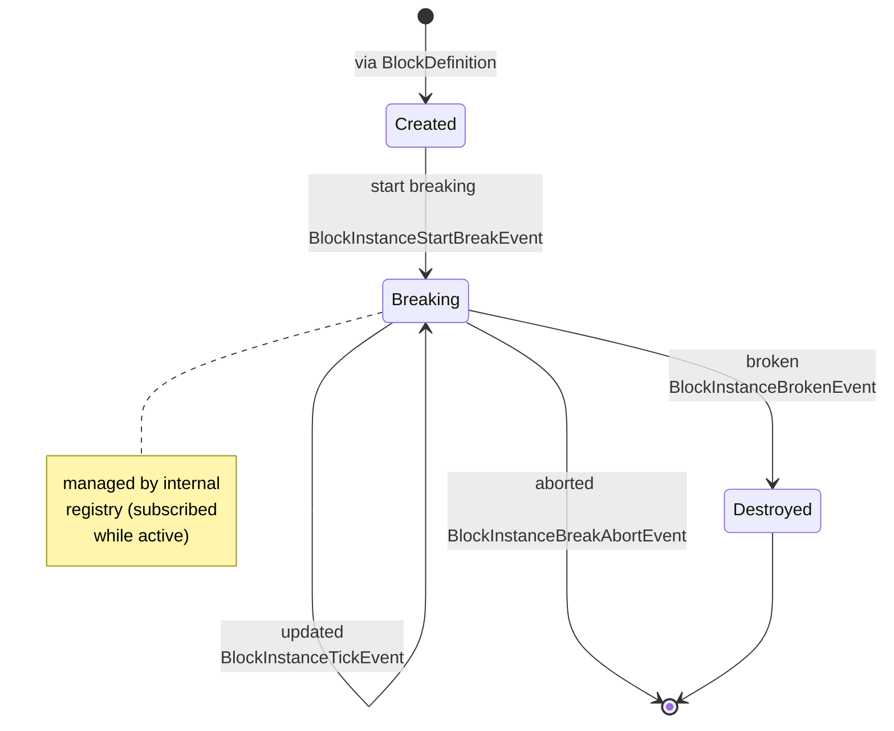

# Block Lifecycle

## Created
The block is in a "useless" state with no association to Blockworks yet.
Effectively a duplicate of its definition. Usually spawned from 
`definition.createInstance()` or `definition.createValidatedInstance()`,
but can also be manually created externally.  
If Blockworks internally calls these methods, it emits a `BlockInstanceCreateEvent`
immediately after.

## Breaking
The block is now subscribed to Blockworks and associated to a BlockBreaker,
and is actively receiving state checks/updates every tick. Emits a 
`BlockInstanceStartBreakEvent` just before it is subscribed and a `BlockInstanceTickEvent`
just before every tick its state is refreshed.

## Destroyed

### Outcome 1: aborted
Blockworks emits a `BlockInstanceBreakAbortEvent` just before the block is
disassociated with its breaker and unsubscribed from Blockworks.
It is now in a similar state as when first created, possibly excluding attributes.

### Outcome 2: broken
Blockworks emits a `BlockInstanceBrokenEvent`, processes appropriate
behavior, then the block is disassociated with its breaker and 
unsubscribed from Blockworks. It is now in a similar state as when
first created, possibly excluding attributes.
