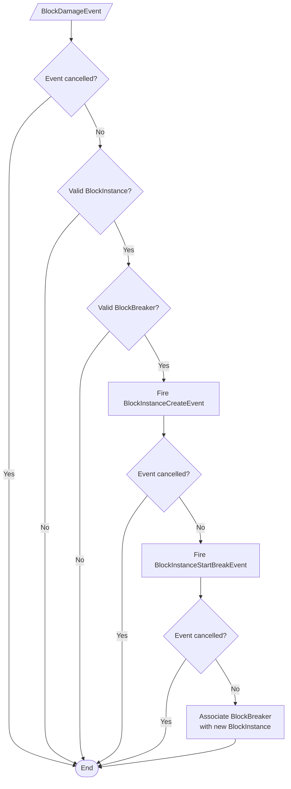
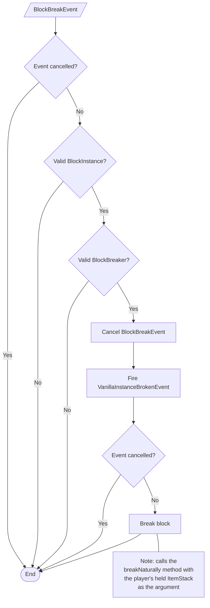
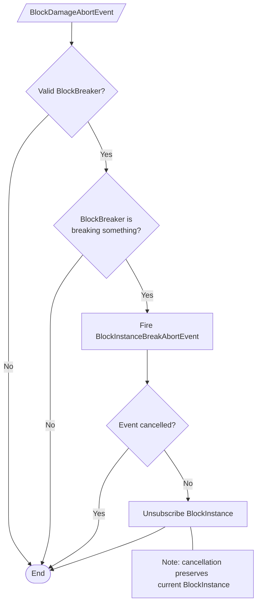

# Event Flow

## Table of Contents
[Block Damage](event-flow.md#block-damage) 
[Block Break](event-flow.md#block-break) 
[Block Break Abort](event-flow.md#block-break-abort)

## Legend
Parallelogram: External Bukkit event  
Rectangle: Process  
Diamond: Condition  
Oval: End of flow

## Block Damage

## Block Break
Note: this event is only listened to for handling completely-vanilla blocks; BlockBreakEvents 
by default only fire when a *client* breaks a block.

## Block Break Abort
